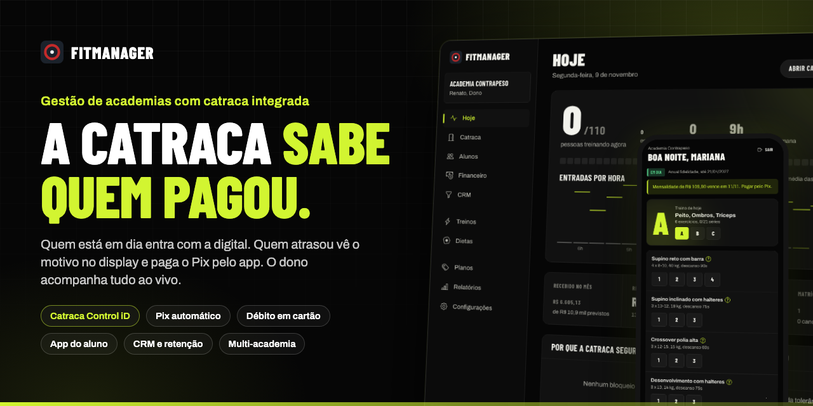
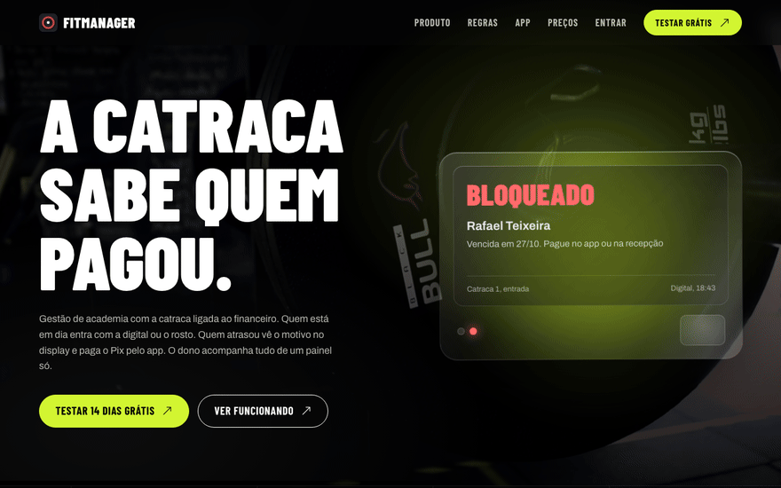
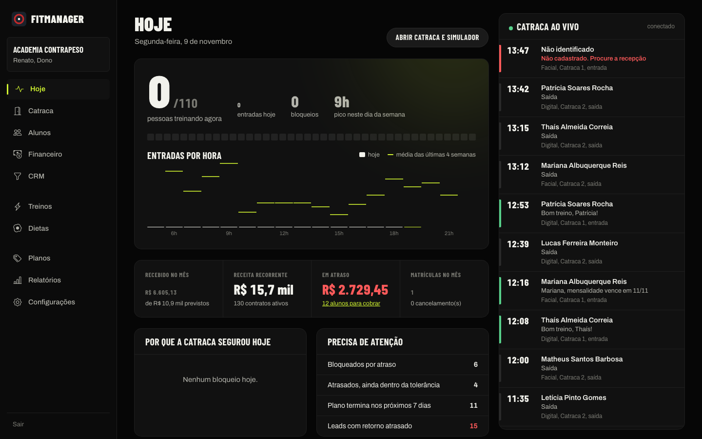
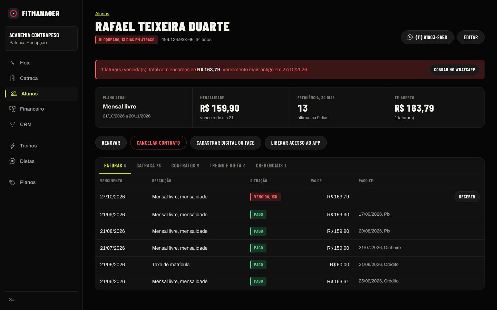
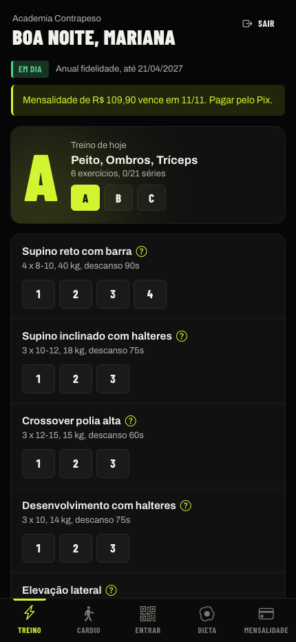
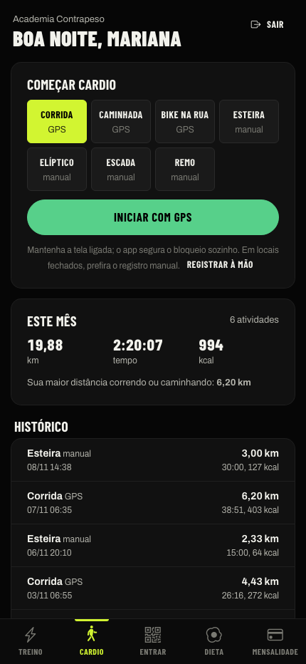
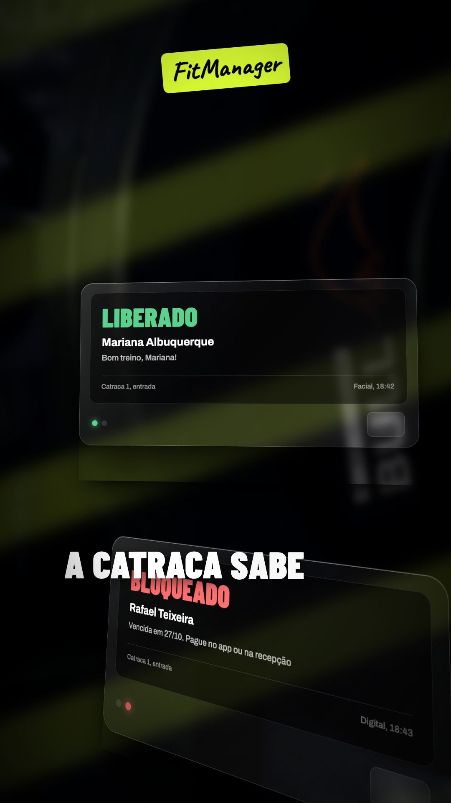
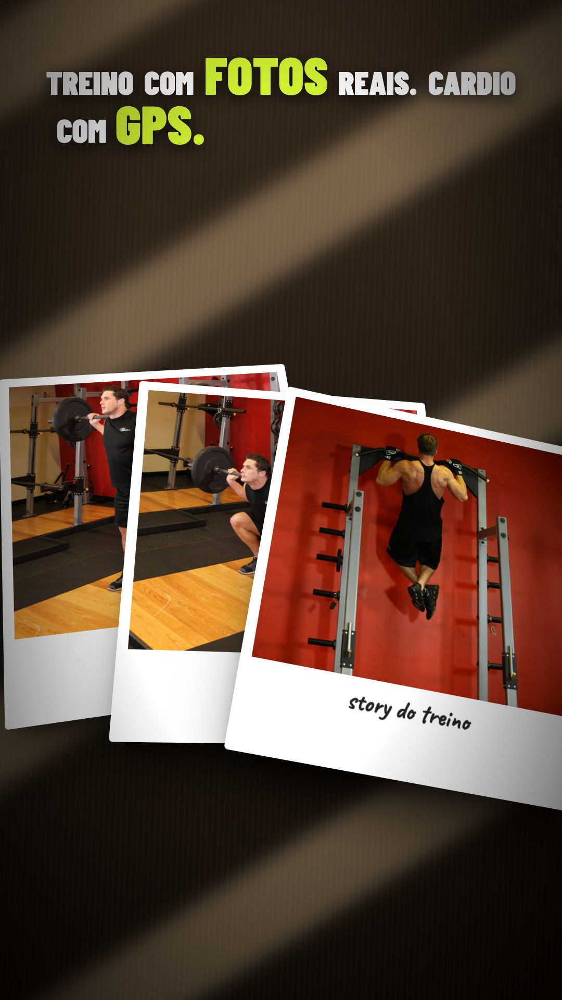

<div align="center">



# FitManager · Gestão de academias com catraca integrada

**SaaS completo para academias de bairro e redes:** catraca Control iD, financeiro com Pix e cartão automáticos, CRM de retenção e um app que o aluno abre todo dia. Tudo em um painel só.

<p>
  <a href="#vídeos"></a>
  <a href="#o-que-tem-dentro"></a>
  <a href="#rodando-em-2-minutos"></a>
  <a href="docs/ARQUITETURA.md"></a>
</p>

<p>
  
  
  
  
  
  
  
  
  
  
</p>

</div>

<div align="center"></div>

### Destaques

| | |
|---|---|
| 🚪 **Catraca que cobra** | Control iD (digital, facial, cartão) no modo online. Quem atrasou vê o motivo no display e paga o Pix pelo app; a confirmação libera sozinha |
| 📡 **Painel ao vivo** | Cada passagem aparece na hora por Server-Sent Events, com quem está treinando agora em relação à lotação |
| 💸 **Financeiro de verdade** | Multa de 2% e juros de 1% ao mês na hora, débito automático no cartão com novas tentativas, estorno que reabre a fatura, webhook idempotente |
| 📱 **App do aluno (PWA)** | Treino com séries por toque, guia de execução com fotos reais, cardio com GPS, passe QR que muda a cada 30 s |
| 📸 **Story para o Instagram** | A foto do aluno com os números por cima, no estilo Strava, marcando a academia e o FitManager |
| 🎯 **CRM e retenção** | Funil de leads com arrastar e soltar, quem sumiu há 10 dias, quem vence em 30, aniversariantes |
| 🏢 **Multi-academia** | Cada academia é uma conta isolada; painel da plataforma com assinaturas, taxas por pagamento e risco de churn |
| 🎬 **Vídeos de venda** | Institucional 16:9 e Reels 9:16 em Remotion, com o produto real na tela, não mockup |

> A academia de demonstração **Contrapeso** vem pronta: 150 alunos, 14 meses de histórico e 4 mil passagens de catraca geradas pelo próprio motor de regras. Atalho: `/entrar?demo=dono`.

---

## Sumário

1. [O problema](#o-problema)
2. [Demonstração](#demonstração)
3. [O que tem dentro](#o-que-tem-dentro)
4. [Rodando em 2 minutos](#rodando-em-2-minutos)
5. [Regras de negócio](#regras-de-negócio)
6. [Catraca](#catraca)
7. [Modelo de receita](#modelo-de-receita)
8. [Vídeos](#vídeos)
9. [Visual](#visual)
10. [Limitações conhecidas](#limitações-conhecidas)
11. [Arquitetura](docs/ARQUITETURA.md)

---

## O problema

Toda academia de bairro conhece a cena: o aluno atrasado passa pela catraca, a recepção não sabe quem pagou, e a conta fecha no fim do mês na raça. Os sistemas do mercado cobram por aluno, pedem uma catraca própria e entregam um app que ninguém abre.

O FitManager liga a catraca ao financeiro. Quem está em dia entra com a digital ou o rosto. Quem atrasou vê o motivo no display e paga o Pix pelo app. A confirmação chega sozinha e a catraca libera. O dono acompanha tudo de um painel só.

https://github.com/user-attachments/assets/7bb19ffb-c380-43d0-a3ae-f5fd26dd592c

<p align="center"><i>Reels de 30 s, formato Instagram. O vídeo institucional de 1 min 41 s está na seção <a href="#vídeos">Vídeos</a>.</i></p>

## Demonstração


| Painel do dono, ao vivo | Ficha do aluno |
|---|---|
|  |  |

<p align="center">
   &nbsp;
  
</p>

A academia de demonstração **Contrapeso** vem pronta: 150 alunos, 14 meses de contratos e faturas, 4 mil passagens de catraca geradas pelo próprio motor de regras, 42 leads no CRM. Logins com senha `fitmanager123`:

| Perfil | E-mail | Vê |
|---|---|---|
| Dono | `dono@contrapeso.com.br` | tudo, inclusive relatórios, planos, equipe e recebimentos |
| Recepção | `recepcao@contrapeso.com.br` | alunos, matrículas, caixa, catraca, CRM |
| Professor | `professor@contrapeso.com.br` | treinos, dietas, frequência |
| Aluno | `aluno@contrapeso.com.br` | só o que é dele, no app |

Atalho: `/entrar?demo=dono` (ou `recepcao`, `professor`, `aluno`) entra direto.

## O que tem dentro

**Catraca**
- Control iD (iDBlock, iDFlex, iDAccess) no modo online, via agente local (`bridge/`): digital, facial, cartão.
- Passe no app: QR assinado que muda a cada 30 s. Leitor USB funciona como teclado.
- Liberação remota pelo painel com justificativa obrigatória e nome do operador.
- Continua funcionando sem internet (cache das últimas decisões).
- Fita ao vivo no painel (Server-Sent Events): cada passagem aparece na hora, com o motivo do bloqueio.

**Financeiro**
- Planos com fidelidade, trancamento, horário e dias liberados, limite de entradas, taxa de matrícula.
- Pix, cartão com débito automático e boleto pelo app, com baixa automática via webhook (Asaas). Modo de testes sem dinheiro real.
- Multa de 2% e juros de 1% ao mês calculados na hora. Recebimento no balcão cancela a cobrança online aberta. Estorno reabre a fatura. Webhook idempotente.
- Desconto da recepção limitado a 10%; acima disso só o dono. Tudo auditado.

**Painel do dono**
- Quem está treinando agora em relação à lotação, entradas por hora comparadas com a média das últimas 4 semanas.
- Receita do mês, recorrência (MRR), inadimplência com quem cobrar primeiro, matrículas e cancelamentos com motivo.
- CRM com funil de leads (arrastar e soltar) e retenção: quem sumiu há 10 dias, quem vence em 30, aniversariantes.
- Relatórios de 12 meses, forma de pagamento, dia da semana, evasão.

**App do aluno (PWA)**
- Ficha com séries marcadas por toque e cronômetro de descanso.
- Guia de execução: fotos de uma pessoa real nas posições inicial e final, mapa corporal com o músculo principal, passo a passo e erros comuns. 44 exercícios prontos.
- Cardio com GPS: distância, ritmo, calorias, elevação, traçado do percurso, recorde pessoal. Esteira e bike da academia à mão.
- Story para o Instagram no estilo Strava: a foto do aluno com os números por cima, marcando a academia e o FitManager.
- Dieta com macros por refeição.

**Plataforma (para quem opera o FitManager)**
- Multi-tenant: cada academia é uma conta isolada, criada pelo cadastro do site.
- Painel `/plataforma` com receita de assinaturas, taxas por pagamento, volume transacionado e academias sem uso (risco de churn).

## Rodando em 2 minutos

Requer Node 22.13 ou mais novo (usa o SQLite nativo do Node; nenhum banco externo).

```bash
git clone https://github.com/ArthurKyo/fitmanager.git
cd fitmanager
npm run setup     # instala api e web, cria a academia de demonstração
npm run dev       # API em :3333 e site em :5173
```

Abra http://localhost:5173. Para testar no celular (GPS e compartilhamento exigem HTTPS): `npm run dev:celular --prefix web` e siga as instruções no terminal.

Testes das regras de negócio (19): `npm test --prefix api`.

Produção: `npm run build --prefix web && npm start --prefix api`. A API serve o front compilado.

### Estrutura

Detalhes, fluxos e decisões em [docs/ARQUITETURA.md](docs/ARQUITETURA.md).

```
api/        Express + node:sqlite
  domain/   regras: billing.js (contratos, faturas, multa), access.js (motor da catraca), exercise-guide.js
  payments/ gateway Asaas + simulado, split da plataforma, débito automático
  routes/   HTTP por área, perfis por middleware
web/        React + Vite: site (src/site), painel (src/admin), app (src/member), plataforma
bridge/     agente local da catraca (Control iD modo online, leitor QR USB)
motion/     vídeos de vendas em Remotion (longo 16:9 e Reels 9:16)
```

## Regras de negócio

A catraca verifica, nesta ordem, e a primeira que falhar vira a mensagem no display:

1. Cadastro ativo
2. Academia aberta
3. Contrato vigente (diferencia "plano encerrado" de "plano começa em…")
4. Matrícula não trancada
5. Inadimplência acima da tolerância configurada (padrão 5 dias)
6. Atestado médico válido, se a academia exigir
7. Dia da semana e horário do plano
8. Limite de entradas por dia
9. Antipassback: sem saída registrada, não entra de novo dentro da janela
10. Lotação máxima

A saída nunca é bloqueada, só registrada.

Outras regras: CPF validado e único por academia; menor de idade exige responsável; biometria exige registro de consentimento (LGPD art. 11) e o template fica só no equipamento; preço do plano congelado no contrato; trancamento mínimo de 7 dias limitado ao saldo, estende o contrato e empurra os vencimentos; cancelamento com fidelidade gera multa sobre as parcelas futuras e exige motivo.

## Catraca

**Sem hardware:** Painel > Catraca tem um simulador que passa pelo mesmo motor de regras.

**Control iD:**
1. Cadastre a catraca no painel com o IP dela e copie o token.
2. No PC da recepção: `cp bridge/config.example.json bridge/config.json`, preencha, `npm run bridge`.
3. No equipamento, ative o modo online apontando para `http://IP-DO-PC:4000`.

O bridge responde `new_user_identified.fcgi` com liberação ou negação e executa comandos do painel (`execute_actions.fcgi`, `remote_enroll.fcgi`). Validado contra um equipamento simulado; confira com o firmware do cliente antes de instalar.

## Modelo de receita

Preço por academia, não por aluno: Essencial R$ 189, Performance R$ 349, Rede sob consulta. Nos pagamentos online, 0,9% por transação (mínimo R$ 0,39) descontado por split direto no gateway. A cobrança é criada na conta Asaas da própria academia; a plataforma não custodia dinheiro.

Variáveis: `FM_PLATFORM_WALLET_ID` (carteira que recebe o split), `FM_FEE_PCT`, `FM_FEE_MIN_CENTS`, `FM_PUBLIC_URL`, `FM_PLATFORM_KEY`, `FM_INSTAGRAM`.

## Vídeos

Vídeo institucional (1 min 41 s, 16:9), narrado, feito para site e apresentação a donos de academia:

https://github.com/user-attachments/assets/a068e3c0-b711-4b93-a2b7-31df3a651906

Os arquivos em alta estão em `motion/out/` (longo 1080p e Reels 1080x1920); versões leves em `docs/`.

`motion/` é um projeto Remotion. Tudo que aparece é o produto de verdade (display, painel, app), não mockup genérico.

```bash
cd motion && npm install && npm run assets
npm run studio           # prévia com linha do tempo
npm run render           # longo 16:9 → out/fitmanager.mp4
npm run render:reels     # Reels 9:16 → out/fitmanager-reels.mp4
```

O Reels usa câmera 3D contínua, objetos em profundidade, luz de persiana, grão de filme e adesivos manuscritos (`src/fx.jsx`). Narração com vozes ElevenLabs (roteiro em `motion/roteiro.md`); `npm run voz` regenera com a sua chave em `motion/.env`.

| | | |
|---|---|---|
|  |  |  |

## Visual

Um sistema para site, painel e app: preto, lime `#D2F531`, Barlow Condensed nos títulos, Archivo no texto, Bootstrap Icons. Site com vídeo de fundo que acompanha a rolagem. Tudo respeita `prefers-reduced-motion`.

## Limitações conhecidas

- Asaas validado contra um servidor que imita a API, não contra a conta real: faça um ciclo completo no sandbox antes de cobrar alunos.
- SQLite atende uma instância; para escalar, migrar para Postgres (as queries são SQL padrão).
- GPS no navegador pausa com a tela bloqueada no iPhone; rastreio em segundo plano exige app nativo.
- Filmagens e vozes dos vídeos são de bancos (Pexels, ElevenLabs); substitua por material próprio antes de publicar.
- Sem e-mail/SMS; senhas provisórias aparecem na tela, com atalhos para WhatsApp.

## Licenças de terceiros

Fotos de exercícios: [free-exercise-db](https://github.com/yuhonas/free-exercise-db) (domínio público). Clipes de vídeo: [Pexels](https://www.pexels.com/license/). Ícones: [Bootstrap Icons](https://icons.getbootstrap.com/) (MIT).
